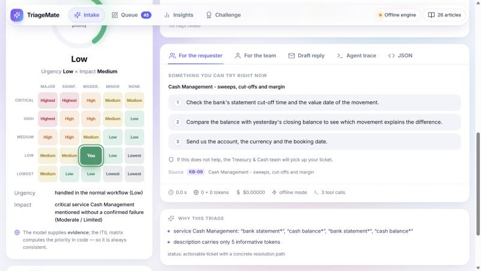
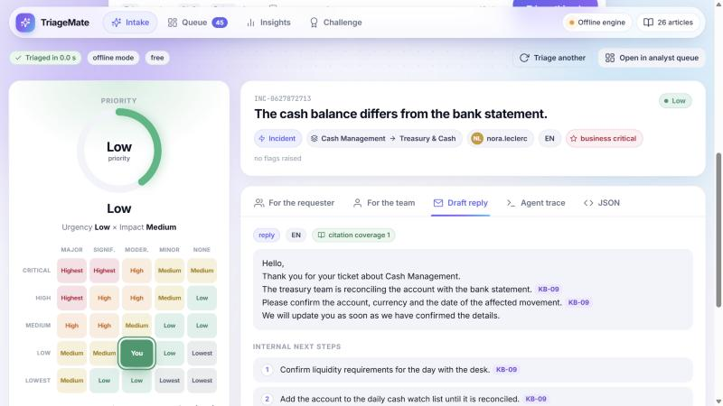

<h1 align="center">Venkata Vinesh Kumar Reddy Atluri</h1>

  <b>ML engineering: time series, signal processing and LLM applications, evaluated honestly.</b>

  <a href="https://venkatavinesh.github.io/PortFolio_Build_Gem/"><b>Portfolio</b></a> ·
  <a href="https://www.linkedin.com/in/venkat-vinesh">LinkedIn</a> ·
  <a href="mailto:venkata-vinesh-kumar-reddy.atluri@etu.ec-lyon.fr">Email</a>

I'm a CS student from **Mahindra University** (B.Tech, CGPA 7.96), in my final year at **École
Centrale de Lyon** (Lyon Centrale Digital Lab 2026–27). I build ML systems on noisy, real-world
signals and measure them against honest baselines. If a number can't be traced back to real data,
or isn't labelled as simulated, it doesn't ship.

> **Available:** 6-month ML / AI engineering internship (LLM applications, ML engineering, applied
> deep learning) from **March 2027**, in **France, Switzerland or Germany**.

---

## Selected work

### 1 · [TriageMate](https://github.com/DaPres/SwissAiWeeks_Team_8): LLM triage co-pilot for service desks
*Team project, Swiss {ai} Weeks hackathon, Zurich 2026 (Swiss Life challenge).*

- The 20,000-ticket dataset turned out to be **173 unique descriptions with effectively random
  priority labels**. A trained classifier could not beat "always predict the majority class".
- So priority is computed with an explicit **ITIL urgency × impact matrix**, the tickets became a
  retrieval library instead of training data, and the LLM is used only where judgment is needed.
- **My part:** the classification and retrieval logic, and the LLM prompting pipeline. The rest
  was the team's.

`Python` `FastAPI` `React` `Azure AI Foundry` `Docker`

  
  
  

### 2 · PRECITEC confocal sensor: peak detection
*Team of 4, LTDS lab, École Centrale de Lyon, Oct 2026. Code private (lab project); details on request.*

Find every surface under a confocal line sensor, even when two surfaces are so close their spectral
peaks overlap.

- **My part:** planning, the robust peak detector, the simulator and benchmark, lab tests on the
  real sensor, retraining the neural network, and integration into the team's app.
- My first Gaussian detectors found **4–11 surfaces where there were 2**: real peaks are not
  Gaussian. Fitting a measured peak template and choosing the peak count with a BIC-style rule
  fixed it.
- **Real sensor:** exactly 2 surfaces on **120/120** glass-slide channels; closest pair resolved on a
  live frame **0.77 peak widths** apart.
- **Simulated benchmark:** 93% of close pairs found at 0.75 peak widths; 97% of single surfaces and
  100% of triples counted correctly.

`Python` `NumPy/SciPy` `PyTorch` `Qt` `pytest`

### 3 · Maintenance Copilot: *in progress*
Anomaly detection on compressor telemetry plus retrieval over equipment manuals, producing cited
diagnoses. It will be evaluated on a strict time split, with any synthetic faults labelled as
synthetic. No results yet; the repo goes public when there are real numbers.

### 4 · [Asset Price Prediction Platform](https://github.com/VenkataVinesh/Asset-Price-Prediction-Platform): LSTM vs ARIMA vs naive
A trained LSTM and an AIC-selected ARIMA behind FastAPI and React, evaluated walk-forward against
"tomorrow = today". Leakage-safe features, train-only scaling saved with the model. On the
simulated random-walk prices **neither model beats naive**, and the dashboard says so.

`Python` `PyTorch` `statsmodels` `FastAPI` `React`

### 5 · [Veltrix](https://github.com/VenkataVinesh/Veltrix): a market-analytics terminal that tells you when there is no edge
- **50.2%** directional hit-rate over **1,500** walk-forward calls, reported in the product as
  **no edge**.
- **GARCH(1,1)** replaced EWMA and raised 95% interval coverage from **91.67% to 94.75%**.
- Every signal shows its indicator votes. ⌘K command palette, live demo:
  [veltrix-terminal-frontend.vercel.app](https://veltrix-terminal-frontend.vercel.app).

`Next.js` `TypeScript` `Supabase` `lightweight-charts` `vitest`

### Also
- [Weather Time-Series Forecasting](https://github.com/VenkataVinesh/Weather-Time-Series-Forecasting):
  an LSTM vs persistence, seasonal-naive and SARIMA baselines, measured against the known noise
  floor of synthetic data.
- [Reinforcement Learning Lab](https://github.com/VenkataVinesh/Reinforcement-Learning-Lab):
  Q-learning and SARSA from scratch, compared over 10 seeds.
- [Portfolio Optimization](https://github.com/VenkataVinesh/Portfolio-Optimization-Dashboard):
  long-only Markowitz frontier and max-Sharpe weights with SciPy SLSQP.

---

## Skills

- **Languages:** Python, TypeScript
- **ML / DL:** PyTorch (LSTM, 1-D U-Net), time-series models (ARIMA/SARIMA, GARCH), signal processing (peak fitting, BIC model selection), walk-forward evaluation
- **LLM & data:** LLM prompting pipelines, retrieval, NumPy/SciPy, pandas, statsmodels
- **Engineering:** FastAPI, Next.js/React, Supabase/Postgres (RLS), Docker, pytest/vitest, GitHub Actions

English (fluent) · Telugu (native) · Hindi (conversational) · French (A1, learning)
